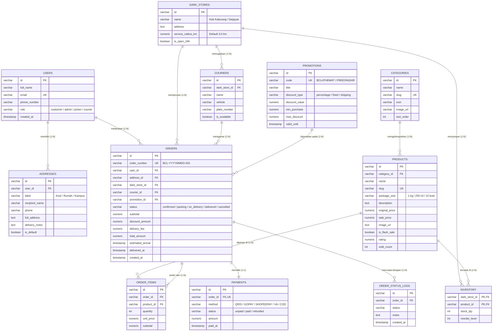

# Perancangan Database BC-LAT Market Online (Quick-Commerce)

Dokumen perancangan database ini disusun untuk memenuhi kelengkapan laporan mata kuliah bisnis, memetakan seluruh entitas transaksi, katalog, persediaan (*dark store inventory*), dan logistik pengantaran 15 menit.

---

## 1. Entity-Relationship Diagram (ERD)

---

## 2. Hubungan Bisnis & Aturan Relasi (Business Logic)

1. **Model Dark Store (Micro-Fulfillment Hub)**:
   - Pesanan dilayani oleh Dark Store terdekat (dalam radius ≤ 3 km) agar target garansi **tiba dalam 15 menit** tercapai.
   - Tabel `inventory` memiliki kunci komposit `(dark_store_id, product_id)` sehingga tiap hub memiliki catatan stok fisik riil masing-masing.

2. **Alur Status Pemesanan & Audit Trail**:
   - `confirmed` (Menit 0) → Dark Store menerima pesanan.
   - `packing` (Menit 2) → Picker menyiapkan barang dalam kantong ramah lingkungan.
   - `on_delivery` (Menit 6) → Kurir kilat berangkat menuju lokasi pelanggan.
   - `delivered` (Menit 14) → Pesanan diterima pelanggan.
   - Setiap perubahan status otomatis tercatat di `order_status_logs` untuk audit SLA kecepatan.

3. **Promosi & Voucher**:
   - Mendukung tipe diskon persentase (`percentage`, dengan batasan `max_discount`), nominal tetap (`fixed`), dan gratis ongkos kirim (`shipping`).

4. **Metode Pembayaran**:
   - Terintegrasi dengan QRIS (Standar Nasional), GoPay, ShopeePay, Virtual Account BCA, dan Bayar di Tempat (COD).

---

## 3. File Terkait dalam Proyek

- **DDL Skema SQL**: `database/schema.sql` (bisa dieksekusi di PostgreSQL / SQLite / MySQL).
- **Seed Data Awal**: `database/seed.sql` (memuat 8 kategori, 30 produk groceries, 3 voucher promosi aktif, dan 3 profil kurir demo).
- **Generator Script**: `scripts/generate-seed.mjs` (menghubungkan data aplikasi langsung ke SQL).
